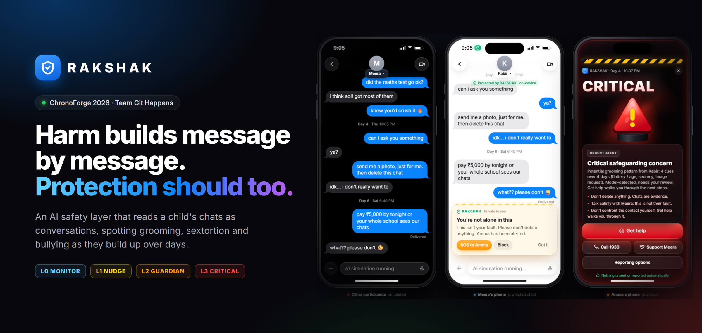

# RAKSHAK

<p align="center">
  
</p>

**An AI safety layer that reads a child's chats as conversations, not single messages.** RAKSHAK spots grooming,
sextortion and bullying as they build up over days and across chats, and responds in steps: a private nudge to the
child first, an alert to the guardian next, and a critical alert with guided help when it matters.

Team **Git Happens** (M Sarvesh, Naren K, S Aditya, Mohit Kumar) · ChronoForge 2026, NITK Surathkal · Cybersecurity
track, *Cities of the Future*.

> Prototype. It runs on a laptop with synthetic conversations, on a web simulator and on real Android phones. Findings
> are *potential safeguarding concerns*, never proof of an offence; thresholds are prototype heuristics.

---

## Contents

1. [What it does](#what-it-does)
2. [How it works](#how-it-works)
3. [The phone app runs on the same models](#the-phone-app-runs-on-the-same-models)
4. [Features](#features)
5. [Quick start](#quick-start)
6. [Running the demo](#running-the-demo)
7. [Privacy by design](#privacy-by-design)
8. [Repository layout](#repository-layout)
9. [Tech stack](#tech-stack)
10. [Tests](#tests)
11. [Limitations](#limitations)
12. [More documentation](#more-documentation)

## What it does

One message rarely looks dangerous: *"you're so mature for your age"*, *"don't tell your parents about our chats"*,
*"send me a pic, just for me"*. Together, over a few days, they are a pattern. RAKSHAK keeps a memory of the evidence in
each conversation, links it to the person sending it, and turns it into an explainable risk level:

| Level | Who hears about it | Example |
|---|---|---|
| L0 · Monitoring | nobody; logged quietly | a compliment from a new contact |
| L1 · Child nudge | only the child, privately | "Asking you to keep chats secret is a warning sign. Want to talk to someone you trust?" |
| L2 · Guardian alert | the guardian (warning signs and dates, never the messages) | secrecy followed by a photo request |
| L3 · Critical | the guardian, full screen, with **Get help** | a threat or a demand for money |

The models label evidence; RAKSHAK's own deterministic engine decides the level, so every decision has a rule trace.

## How it works

```
   phones (Android app or browser)          laptop running RAKSHAK
 ┌───────────────────────────────┐      ┌──────────────────────────────────────────────────────┐
 │ Kabir's messenger             │      │ inference service (FastAPI)                           │
 │ Meera's protected messenger ──┼─────▶│  context: the whole chat + findings from other chats  │
 │ Amma's RAKSHAK Guardian  ◀────┼──┐   │  RoBERTa (per message)  ─┐                            │
 └───────────────────────────────┘  │   │  Qwen3.5 4B via Ollama ──┼─ verification ─ fusion     │
   web simulator (three drawn       │   │  confirmation gate ─ case memory (SQLite)             │
   phones + engine panels)          │   │ deterministic engine: tracks, score, level, trace    │
                                    └───┤ sync relay: chat devices share the case;             │
                                        │ guardian devices get alert summaries only            │
                                        └──────────────────────────────────────────────────────┘
```

1. **Context.** Each new message is analysed together with the whole conversation, earlier findings in it, and related
   findings from the child's other chats. Message IDs are aliased and the output schema only allows real messages and
   participants.
2. **Two models.** RoBERTa scores each message for bullying; Qwen3.5 4B (local, via Ollama) reads the whole chat, writes
   its reading of the conversation first, then reports findings (cue, target, modifier such as banter or quote,
   confidence).
3. **Verification and fusion.** New findings get a second check against the transcript; the two models' outputs are
   fused into one evidence row per message and cue, so nothing is counted twice.
4. **Confirmation gate.** Only confirmed evidence can score or alert. Uncertain readings wait for later messages.
   Alerts whose evidence is later retracted are shown as *withdrawn*, never silently deleted.
5. **Engine.** Weighted cues with decay, stage progression (rapport → secrecy → request → coercion), safety floors
   (a threat is always L3), per-contact grooming tracks and a child-level bullying track. Each level rise alerts once.

### Two ways it runs: the full AI system, and the rules fallback

| | **Full system (intended)** | **Rules fallback (laptops without the models)** |
|---|---|---|
| Hardware | a laptop with an NVIDIA GPU (tested: RTX 5060 Laptop, 8 GB) | any laptop, no GPU needed |
| Per-message classifier | **RoBERTa** (`nayan90k/roberta-finetuned-cyberbullying-detection`, CPU) | off (`RAKSHAK_ROBERTA_ENABLED=0` skips loading it) |
| Whole-conversation reading | **Qwen3.5 4B via Ollama** (`qwen3.5:4b`, on the GPU) | fixed phrase lists, one message at a time |
| Verification pass | yes (Qwen re-checks new findings against the transcript) | no |
| Everything after that | fusion, confirmation gate, case memory, engine, alerts, phones: **the same code** | the same |
| Speed | ~3–8 s per analysed message | instant |
| Shown in the app as | *Local AI ready · RoBERTa (cpu) + qwen3.5:4b* | *Ollama not running · rules fallback (not AI)*, and every finding says "rules fallback matched …" |

The fallback switches on by itself when Ollama is not running or `qwen3.5:4b` is not pulled, so the demo (web and
phones) still works on a laptop without the models. It is a stand-in, not the product: it cannot tell banter, quotes or
sarcasm from real harm the way Qwen does, and it is never presented as AI. Set `RAKSHAK_RULES_FALLBACK=0` to make
analysis fail instead. On the team's GPU laptop the same commands run the full system; nothing else changes.

## The phone app runs on the same models

The Android app is not a mock-up. Every message typed on a phone goes to the laptop running RAKSHAK, is analysed by
**RoBERTa and Qwen** through exactly the same pipeline as the web simulator, and the result comes back to the phones in
real time. (When the laptop runs the rules fallback instead, the phones get the fallback's results the same way.)

- **Meera's phone** (the protected child): a messenger with RAKSHAK's private nudges, *Pause before you send* when a
  photo is about to go to a flagged contact, a contact profile ("Not in your contacts · account created 3 days ago")
  and an SOS button.
- **Kabir's phone** (the other person): a plain messenger with typing dots and read receipts. Nothing on it mentions
  RAKSHAK; once blocked, his messages show *Not delivered*.
- **Amma's phone** (the guardian): **RAKSHAK Guardian**, with a lock screen that wakes up for alerts, **real Android
  notifications**, Home / Alerts / Report / Settings, Get help, and a background service so alerts keep arriving.
- **Temporary guardians:** Amma creates an invite QR (1 hour to 3 days, optionally critical-only) for a teacher or
  relative; the server enforces the end time and Amma can revoke it.

Phones join by **scanning a QR code** on the laptop:

| Where the phones are | Start the laptop with | Phone needs |
|---|---|---|
| Same Wi-Fi or hotspot | `npm run server:lan` | the APK (`rakshak/apk/RAKSHAK-debug.apk`) |
| Anywhere with internet | `npm run server:remote` (Cloudflare quick tunnel) | the APK, **or nothing**: the phone camera opens the same app in the browser |

The phones never run a model themselves; the laptop with the GPU does the analysis for all of them.

## Features

**Web simulator (laptop)**
- **Three modes.** *A · Guided Demo* plays scripted examples through the live pipeline; *B · Continue the
  Conversation* loads an earlier chat up to a checkpoint, analyses it, then you type the next messages; *C · Free Chat*
  starts from nothing. Private and group chats, multi-day simulation clock.
- **Studio panel** to pick examples, checkpoints and case studies; switching modes never destroys the case.
- **Five core examples**: friendly banter (must not alert), cyberbullying, six-day grooming, five days across four
  chats, a group pile-on.
- **Case studies**: fictional reconstructions of the Amanda Todd and Jordan DeMay cases, with sourced background,
  a pause at the first real guardian alert ("an opportunity to intervene") and what the pipeline flagged in this run.
- **Engine drawer**: case score over time, case memory with each finding's model provenance, per-message trace
  (RoBERTa score, Qwen verdict, fusion, rules, latency, context size) and the full model output.
- **Get help** for the guardian: understand the concern (recorded messages, AI interpretation and the deterministic
  level kept separate), support the child (conversation guide, next steps, block, helplines 112 / 1098 / Tele-MANAS),
  an evidence review that exports a **redacted HTML/JSON report**, and complaint options (cybercrime.gov.in, 1930,
  anonymous-reporting eligibility, Take It Down). Nothing is ever submitted automatically.
- **Projector view** (`/#/engine`) for the real-phone demo: engine panels, connected devices and what each received.
- **Two backends**: *Hybrid · Local* (RoBERTa + Qwen) and *ChatGPT · Cloud* (Sign in with ChatGPT, owner-initiated only).

**Android app** — see [above](#the-phone-app-runs-on-the-same-models).

## Quick start

On the laptop that runs the demo (Windows; the GPU laptop is best). Full step-by-step guide, including updating an
existing copy: [`rakshak/README.md` → Team setup](rakshak/README.md#0-team-setup-start-here).

```powershell
# once
winget install Git.Git OpenJS.NodeJS.LTS Python.Python.3.12 Ollama.Ollama
git clone https://github.com/S-Aditya-72/Rakshak.git
cd Rakshak\rakshak
npm install
powershell -ExecutionPolicy Bypass -File scripts/setup-server.ps1   # Python venv + RoBERTa
ollama pull qwen3.5:4b                                               # ~3.3 GB

# every time (two terminals, inside rakshak/)
npm run server:lan        # models + phone relay   (server:remote = also over the internet)
npm run dev               # web UI → http://127.0.0.1:5280
```

Phones: install `rakshak/apk/RAKSHAK-debug.apk`, then on the laptop open `http://127.0.0.1:5280/#/engine` →
**Connect phones** → scan the QR → choose Meera, Kabir or Amma. For phones elsewhere: `winget install
Cloudflare.cloudflared` once and start with `npm run server:remote`.

## Running the demo

1. **Web only:** open `http://127.0.0.1:5280` → *Launch simulation* → Studio → *Six days, one stranger* → Play. Watch
   the nudge reach Meera, then Amma's alert, then CRITICAL; open the **Engine** drawer and **Get help**.
2. **Real phones:** `/#/engine` → Connect phones → three phones scan → **C · Free Chat** → *Start new conversation* →
   type on Kabir's phone. Meera gets nudges; Amma's phone notifies; try Talk to Meera, Block, Call 1930 (opens the
   dialer only) and Get help.
3. **History:** **B** → *Cyberbullying* → a checkpoint → *Load history and continue* → type the next message.

## Privacy by design

- The guardian sees **warning signs, dates and the risk level, never the child's messages**. The sync relay itself drops
  any guardian-bound data that carries message text, drafts, evidence or model output, and counts it.
- L1 nudges stay private to the child.
- Evidence review and the redacted report stay on the laptop; on the guardian's phone Get help works from the alert
  summary only.
- Remote access needs an access code; tunnelled requests are always treated as remote; temporary guardians get their
  own time-limited codes.
- Local analysis runs on the laptop; raw chat text is not logged by default. All demo conversations are synthetic.

## Repository layout

```
rakshak/
  apps/server/          inference service (FastAPI): pipeline, models, fusion, case memory, sync relay
  apps/web/             React web app (simulator + the phone app) · android/ = Capacitor project
  apps/siwc-companion/  optional Sign in with ChatGPT companion
  packages/engine/      deterministic scoring engine (computeRisk)
  packages/shared/      analysis contract (TypeScript + zod)
  prompts/ scenarios/   model prompts · demo scenarios, case studies, eval fixtures
  apk/                  RAKSHAK-debug.apk (ready to install)
  README.md MOBILE.md   detailed docs
HANDOFF.md              project state, decisions, gotchas
Plan.md                 original architecture plan
```

## Tech stack

React 18 · Vite · TypeScript · zustand · framer-motion · Capacitor 8 (Android) · FastAPI · SQLite · Hugging Face
Transformers (RoBERTa, `nayan90k/roberta-finetuned-cyberbullying-detection`) · Ollama (`qwen3.5:4b`) · WebSocket relay ·
Cloudflare quick tunnels · Vitest · pytest.

## Tests

```powershell
cd rakshak
npm test               # 66 tests: engine, modes/history, store, report redaction, QR links
npm run test:server    # 100 tests: pipeline, fusion, confirmation gate, history, remote access, relay, rules fallback
npm run eval           # real models over the scenarios → eval/reports/latest.md
```

The unit tests use fake models: they check the bookkeeping, not model accuracy. See `rakshak/eval/reports/latest.md`
for real-model results, misses included.

## Limitations

- Qwen3.5 4B is a small model and still makes mistakes; verification and fusion reduce them, every finding shows its
  provenance so a human can judge it. RoBERTa is English-only.
- About 3–8 s per analysed message on an RTX 5060 laptop.
- The phone app is a debug-signed prototype: it does not read real chats on the phone (the messenger is RAKSHAK's own),
  and notifications need the app (or the browser tab) to be running.
- The demo scenarios were written by the team; passing them is not evidence of general accuracy.

## More documentation

- [`rakshak/README.md`](rakshak/README.md) — team setup, architecture, pipeline, configuration, ChatGPT backend, tests.
- [`rakshak/MOBILE.md`](rakshak/MOBILE.md) — the Android app: roles, QR setup, every button, temporary guardians,
  phones over the internet, troubleshooting.
- [`HANDOFF.md`](HANDOFF.md) — what is done, what is pending, gotchas.
